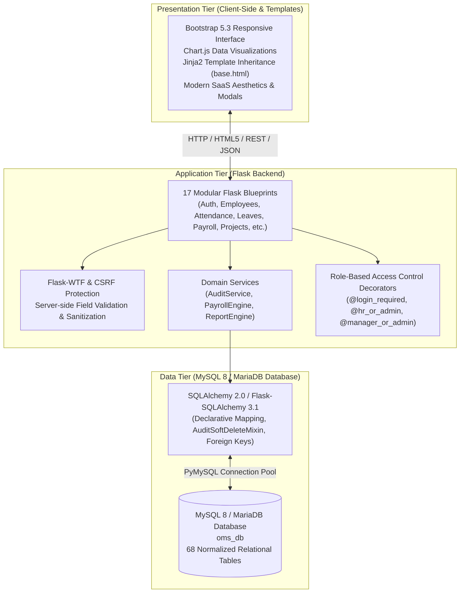

# Enterprise Office Management System (OMS)

[](https://www.python.org/)
[](https://flask.palletsprojects.com/)
[](https://www.mysql.com/)
[](https://flask-sqlalchemy.palletsprojects.com/)
[](https://getbootstrap.com/)
[-success.svg)]()
[]()

> **Academic Project Submission**  
> **Course**: Advanced Web Development & Enterprise Software Design  
> **Project Title**: Enterprise Office Management System (OMS)  
> **Architecture**: Three-Tier Relational Enterprise Architecture (Flask + MySQL 8 + Bootstrap 5)  

---

## Table of Contents
1. [Executive Summary & Architecture](#1-executive-summary--architecture)
2. [Role-Based Access Control (RBAC) & Default Credentials](#2-role-based-access-control-rbac--default-credentials)
3. [Database Architecture & 68 Normalized Tables](#3-database-architecture--68-normalized-tables)
4. [Enterprise Database Entity Relationship Diagram (Mermaid ERD)](#4-enterprise-database-entity-relationship-diagram-mermaid-erd)
5. [Audit & Soft-Delete Architecture](#5-audit--soft-delete-architecture)
6. [Core Functional Modules](#6-core-functional-modules)
7. [Enterprise Reports & Analytics Hub (47 Reports)](#7-enterprise-reports--analytics-hub-47-reports)
8. [Installation & Local Setup Guide](#8-installation--local-setup-guide)
9. [Automated Testing & Quality Assurance](#9-automated-testing--quality-assurance)
10. [University Viva & Project Defense Guide](#10-university-viva--project-defense-guide)

---

## 1. Executive Summary & Architecture

The **Enterprise Office Management System (OMS)** is a production-grade, secure, three-tier web application engineered for modern organizational operations. It centralizes human resource administration, organizational hierarchy, time & attendance tracking, employee leave workflows, automated monthly payroll computation, project and sprint task boards, client customer relationship management (CRM), physical and digital asset lifecycle tracking, corporate document archiving, internal communication, and comprehensive security auditing.



---

## 2. Role-Based Access Control (RBAC) & Default Credentials

The system enforces strict multi-tier permissions through session-authenticated RBAC. Every route checks the logged-in user's role before allowing query execution or modifications:

| Role Name | Access Scope & Responsibilities | Seed Username | Seed Password |
|---|---|---|---|
| **Super Admin** | Full root authority over all 17 modules, user accounts, role delegations, global system parameters, Recycle Bin purge, and immutable audit logs. | `admin` | `Admin@123` |
| **HR Manager** | Employee records, designations, department allocation, attendance adjustments, leave approvals, payroll batches, bonuses, and asset assignment. | `hrmanager` | `Hr@123` |
| **Department Manager**| Department staff oversight, project sprints, task allocation, project milestones, team member additions, and client interaction logs. | `deptmanager` | `Manager@123` |
| **Employee** | Personal self-service portal, virtual punch in/out, personal payslips, leave applications, task cards, and internal communication. | `johndoe` | `Emp@123` |

---

## 3. Database Architecture & 68 Normalized Tables

The database is structured into **68 relational tables** conforming to 3NF (Third Normal Form) without synthetic redundancy:

```
oms_db (68 Tables Total)
├── Module A: User & Access Management (8 Tables)
│   ├── users                      # Authentication credentials and status
│   ├── roles                      # RBAC definitions (Admin, HR, Manager, Employee)
│   ├── permissions                # Fine-grained operational permissions
│   ├── user_roles                 # Many-to-Many association: User <-> Role
│   ├── role_permissions          # Many-to-Many association: Role <-> Permission
│   ├── user_sessions              # Active session management and token tracking
│   ├── login_history              # Security ledger: IP address, user agent, login state
│   └── password_reset_tokens      # Expirable cryptographic tokens for password recovery
│
├── Module B: Department & Employee Management (12 Tables)
│   ├── departments                # Business units with code, manager, and operating budget
│   ├── department_locations       # Multi-campus and branch office mapping
│   ├── designations               # Corporate ranks with salary bands (min/max)
│   ├── employees                  # Core personnel records with unique emp_code
│   ├── employee_profiles          # Bio-data: DOB, marital status, nationality, passport
│   ├── employee_contacts          # Secondary phones, corporate emails, extensions
│   ├── employee_addresses         # Residential and permanent address geolocation
│   ├── employee_education         # Academic degrees, universities, GPA/grades, passing years
│   ├── employee_experience        # Prior employment history, employers, tenures
│   ├── employee_documents         # Digital verification uploads (resumes, contracts, IDs)
│   ├── employee_skills            # Competency ledger with proficiency rankings
│   └── employee_emergency_contacts# Primary and secondary emergency response contacts
│
├── Module C: Attendance Management (5 Tables)
│   ├── shifts                     # Shift schedules with start time, end time, grace periods
│   ├── shift_assignments          # Employee-to-Shift allocations
│   ├── attendance                 # Daily attendance registry (check-in, check-out, work hours)
│   ├── attendance_logs            # Biometric clock punch telemetry and device logs
│   └── holidays                   # Recognized statutory and corporate holiday calendar
│
├── Module D: Leave Management (5 Tables)
│   ├── leave_types                # Paid annual, sick, maternity, bereavement definitions
│   ├── leave_balances             # Yearly employee entitlement vs consumed days
│   ├── leave_requests             # Employee leave applications and date ranges
│   ├── leave_approvals            # Multi-level approval signoffs and manager comments
│   └── leave_attachments          # Medical certificates and documentation uploads
│
├── Module E: Payroll Management (6 Tables)
│   ├── salary_structures          # Base wage, HRA, medical, transport allowances
│   ├── employee_salaries          # Active compensation assignments per employee
│   ├── payrolls                   # Monthly payroll batch master ledger
│   ├── payroll_details            # Line-item salary slip breakdowns per employee
│   ├── bonuses                    # Performance, festival, and milestone discretionary pay
│   └── deductions                 # Tax withholdings, insurance, pension, advances
│
├── Module F: Finance & Accounting (5 Tables)
│   ├── expense_categories         # Corporate cost classifications
│   ├── expenses                   # Expense reimbursement claims and merchant receipts
│   ├── expense_approvals          # Financial comptroller signoffs and audit reviews
│   ├── invoices                   # B2B client invoices with line items, tax, due dates
│   └── payments                   # Received client payment transactions & settlement ledger
│
├── Module G: Project & Task Management (6 Tables)
│   ├── projects                   # Client projects, deadlines, budgets, and milestones
│   ├── project_members            # Team roster and project-specific roles
│   ├── tasks                      # Sprint tasks with priorities, estimates, completion %
│   ├── task_assignments          # Assignee delegation per task
│   ├── task_comments             # Collaboration dialogue and feedback threads
│   └── task_attachments          # Deliverables and task specification files
│
├── Module H: Client CRM Management (4 Tables)
│   ├── clients                    # Corporate client entities, industry, and address
│   ├── client_contacts            # External point-of-contact directory
│   ├── client_projects            # Client-to-Project association mapping
│   └── client_interactions        # CRM activity timeline (meetings, calls, discovery)
│
├── Module I: Asset Management (5 Tables)
│   ├── asset_categories           # Hardware, IT peripherals, vehicles, furniture
│   ├── assets                     # Physical inventory with barcodes, serials, valuation
│   ├── asset_assignments          # Custody allocations to staff members
│   ├── asset_maintenance          # Servicing schedules, repairs, vendor costs
│   └── asset_requests             # Requisitions submitted by staff for new hardware
│
├── Module J: Document Repository (4 Tables)
│   ├── document_categories        # Corporate policy, legal, technical categories
│   ├── documents                  # Master document records and file paths
│   ├── document_versions          # Version control logs with changelogs and author IDs
│   └── document_shares            # Access grants per department or individual user
│
├── Module K: Communication Management (4 Tables)
│   ├── announcements              # Organization-wide broadcasts with priority banners
│   ├── notifications              # Real-time event notifications per user account
│   ├── messages                   # Direct internal peer-to-peer messages
│   └── message_recipients         # Dispatch ledger and read receipt tracking
│
└── Module L: System Management & Auditing (4 Tables)
    ├── system_settings            # Key-value runtime configuration parameters
    ├── audit_logs                 # Immutable security audit trail (old/new value JSON)
    ├── approval_workflows         # Declarative business logic steps
    └── approval_history           # Historical workflow transitions
```

---

## 4. Enterprise Database Entity Relationship Diagram (Mermaid ERD)

```mermaid
erDiagram
    users ||--o{ user_roles : "assigned"
    roles ||--o{ user_roles : "grants"
    roles ||--o{ role_permissions : "contains"
    permissions ||--o{ role_permissions : "included_in"
    users ||--o{ user_sessions : "holds"
    users ||--o{ login_history : "logs"
    users ||--o1 employees : "authenticates"
    
    departments ||--o{ designations : "has"
    departments ||--o{ employees : "employs"
    departments ||--o{ department_locations : "located_at"
    designations ||--o{ employees : "designates"
    
    employees ||--o1 employee_profiles : "detailed_by"
    employees ||--o{ employee_contacts : "has_contact"
    employees ||--o{ employee_addresses : "resides_at"
    employees ||--o{ employee_education : "achieved"
    employees ||--o{ employee_experience : "worked_at"
    employees ||--o{ employee_skills : "possesses"
    employees ||--o{ employee_emergency_contacts : "contacts"
    employees ||--o{ employee_documents : "uploaded"
    
    employees ||--o{ attendance : "punches"
    attendance ||--o{ attendance_logs : "records"
    shifts ||--o{ shift_assignments : "allocated"
    employees ||--o{ shift_assignments : "works"
    
    leave_types ||--o{ leave_balances : "allocated_to"
    employees ||--o{ leave_balances : "owns"
    employees ||--o{ leave_requests : "submits"
    leave_types ||--o{ leave_requests : "categorizes"
    leave_requests ||--o{ leave_approvals : "reviewed_by"
    
    employees ||--o{ employee_salaries : "earns"
    salary_structures ||--o{ employee_salaries : "structures"
    payrolls ||--o{ payroll_details : "contains"
    employees ||--o{ payroll_details : "paid_in"
    employees ||--o{ bonuses : "awarded"
    employees ||--o{ deductions : "deducted"
    
    clients ||--o{ client_contacts : "represents"
    clients ||--o{ client_interactions : "logged"
    clients ||--o{ projects : "contracts"
    clients ||--o{ invoices : "billed_to"
    invoices ||--o{ payments : "settled_by"
    
    projects ||--o{ project_members : "staffed_by"
    employees ||--o{ project_members : "participates"
    projects ||--o{ tasks : "divided_into"
    tasks ||--o{ task_assignments : "assigned_to"
    employees ||--o{ task_assignments : "executes"
    tasks ||--o{ task_comments : "discussed_in"
    
    asset_categories ||--o{ assets : "classifies"
    assets ||--o{ asset_assignments : "assigned_to"
    employees ||--o{ asset_assignments : "holds_custody"
    assets ||--o{ asset_maintenance : "serviced"
    employees ||--o{ asset_requests : "requisitions"
    
    document_categories ||--o{ documents : "classifies"
    documents ||--o{ document_versions : "versioned_as"
    documents ||--o{ document_shares : "shared_with"
    
    users ||--o{ messages : "sends"
    messages ||--o{ message_recipients : "delivered_to"
    users ||--o{ notifications : "receives"
    users ||--o{ announcements : "broadcasts"
    
    users ||--o{ audit_logs : "triggers"
```

---

## 5. Audit & Soft-Delete Architecture

### The `AuditSoftDeleteMixin`
All core business entities inherit from a shared, highly reusable mixin (`app/models/mixins.py`):

```python
class AuditSoftDeleteMixin:
    id = db.Column(db.Integer, primary_key=True, autoincrement=True)
    created_at = db.Column(db.DateTime, default=datetime.utcnow, nullable=False)
    created_by = db.Column(db.Integer, db.ForeignKey('users.id', ondelete='SET NULL'), nullable=True)
    updated_at = db.Column(db.DateTime, default=datetime.utcnow, onupdate=datetime.utcnow, nullable=False)
    updated_by = db.Column(db.Integer, db.ForeignKey('users.id', ondelete='SET NULL'), nullable=True)
    status = db.Column(db.String(30), default='Active', nullable=False)
    is_deleted = db.Column(db.Boolean, default=False, nullable=False, index=True)
    deleted_at = db.Column(db.DateTime, nullable=True)
    deleted_by = db.Column(db.Integer, db.ForeignKey('users.id', ondelete='SET NULL'), nullable=True)
```

### Soft-Delete & Recycle Bin Lifecycle
1. **Zero Data Loss**: Standard deletion requests (`POST /<module>/<id>/delete`) flag `is_deleted = True`, stamp `deleted_at = datetime.utcnow()`, and store the actor's `user_id`.
2. **Transparent Query Filtering**:
   - Active views query via `Model.active_query()` (`is_deleted == False`).
   - Trash views query via `Model.trash_query()` (`is_deleted == True`).
3. **One-Click Restoration**:
   - Administrators can access `/recycle-bin/` to review deleted entities across all modules.
   - Restoring a record flips `is_deleted = False`, clears timestamps, and brings the record back into the active database index.
4. **Permanent Purging**: Only the **Super Admin** role can execute permanent physical database deletions from the Recycle Bin.
5. **Security Audit Logging**: Every `CREATE`, `UPDATE`, `DELETE`, and `RESTORE` operation writes a serialized JSON snapshot of previous and updated attributes into `audit_logs`.

---

## 6. Core Functional Modules

### 1. Human Resources & Onboarding
- Comprehensive employee profile management with employee codes (`EMP-1001`), job designations, salary baselines, and managerial hierarchy.
- Relational bio-data tabs: Educational qualifications, past employment tenures, skills matrix with proficiency levels, and emergency contacts.
- Real-time departmental budgeting overview and headcounts.

### 2. Time & Attendance (Biometric / Virtual Punch)
- Interactive virtual punch terminal allowing employees to Check-In and Check-Out with real-time status indicators.
- Automatic duration computation for working hours.
- Shift allocation with grace periods and holiday calendars.

### 3. Leave Management & Approval Cycle
- Entitlement tracking per leave category (Annual, Sick, Casual, Maternity).
- Multi-tier review workflow: Managers/HR can review pending applications, view reason and duration, and approve or reject with comments.
- Automatic decrement of employee leave balances upon approval.

### 4. Payroll Computation & Salary Slips
- Automated monthly payroll engine: calculates Gross Salary, additions (bonuses), deductions (taxes, pensions), and net payable amount.
- Formal, professional, printable salary slip (`/payroll/payslip/<id>`) complete with company branding, tax breakdowns, and disbursement confirmation.
- Payroll batch management: Draft review and one-click "Mark as Paid" status transitions.

### 5. Sprint Kanban Task Board & Projects
- Visual 4-column Sprint Kanban board: `To-Do`, `In-Progress`, `Review`, `Completed`.
- Project progress tracking with priority badges, deadlines, and completion percentages.
- Task detail modals with discussion threads, assignee tags, and time estimates.

### 6. Client CRM & Financial Ledger
- Corporate client portfolio with industry categories and interaction histories.
- Financial invoicing system: Line-item invoices, payment status tracking (`Sent`, `Partial`, `Paid`), and receipt ledger.
- Expense tracking with managerial approval workflows.

### 7. Asset Registry & Hardware Lifecycle
- Physical asset management with serial numbers, barcode tags, purchase dates, warranty tracking, and current status (`Available`, `Assigned`, `Maintenance`).
- Staff equipment requisition portal and check-in/return workflows.

### 8. Corporate Document Repository
- Categorized document archiving with file size, extension detection, and confidentiality flags.
- Document revision history tracking with version numbers (e.g., `1.0`, `1.1`) and change summaries.

### 9. Internal Communication & Notice Board
- Priority company announcements with dismissible alerts.
- Notifications feed with read/unread markers.
- Internal direct messaging inbox between employees.

---

## 7. Enterprise Reports & Analytics Hub (47 Reports)

The OMS Reports Hub (`/reports/`) features **47 pre-built operational reports** powered by real SQL queries with instant **CSV** and styled **Microsoft Excel (.xlsx)** exports:

| Category | Report Title & Code | Operational Description |
|---|---|---|
| **Employees** | `emp_directory` | Complete roster of active employees with department and designation |
| **Employees** | `emp_dept` | Workforce distribution segmented across departments |
| **Employees** | `emp_desig` | Workforce hierarchy grouped by job designations |
| **Employees** | `emp_joiners` | New joiners onboarded within the last 12 months |
| **Employees** | `emp_skills` | Cross-organizational skill competencies and proficiency tiers |
| **Employees** | `emp_emergency` | Primary emergency response contacts and next-of-kin |
| **Employees** | `emp_exp` | Prior industry experience and tenures of employees |
| **Employees** | `emp_edu` | Academic degrees, institutions, and majors across staff |
| **Employees** | `emp_docs` | Compliance audit of submitted identity proofs and contracts |
| **Employees** | `emp_salary_band` | Workforce compensation distributed across salary tiers |
| **Attendance** | `att_daily` | Real-time daily workforce clock-in and clock-out register |
| **Attendance** | `att_monthly` | Monthly aggregated attendance register with present days |
| **Attendance** | `att_late` | Late check-in occurrences past scheduled shift start |
| **Attendance** | `att_hours` | Total regular and overtime hours worked per employee |
| **Attendance** | `att_shifts` | Active shift schedules, timings, and employee rosters |
| **Attendance** | `att_holidays` | Corporate annual holiday calendar and observed non-working days |
| **Leaves** | `leave_summary` | Aggregate leave application ledger by status |
| **Leaves** | `leave_balance` | Allocated, consumed, and remaining leave quotas per employee |
| **Leaves** | `leave_dept` | Departmental leave consumption comparisons |
| **Leaves** | `leave_types` | Leave category distribution (Annual, Sick, Casual) |
| **Leaves** | `leave_pending` | Pending leave requests awaiting managerial review |
| **Payroll** | `pay_summary` | Historical batch payroll disbursement summary |
| **Payroll** | `pay_dept` | Department-level salary expense allocations |
| **Payroll** | `pay_slip_list` | Master payroll register with gross, deductions, and net payouts |
| **Payroll** | `pay_bonus` | Performance and milestone bonuses disbursed |
| **Payroll** | `pay_deduct` | Tax withholdings, insurance, and statutory deductions |
| **Finance** | `fin_expenses` | Corporate expenditure ledger and receipt audit |
| **Finance** | `fin_exp_cat` | Operating expenditures segmented by expense category |
| **Finance** | `fin_invoices` | B2B client invoices, billing totals, and settlement statuses |
| **Finance** | `fin_aging` | Unsettled accounts receivable categorized by due dates |
| **Finance** | `fin_payments` | Client payment receipt ledger and transaction history |
| **Projects** | `proj_master` | Active and delivered client projects with budgets |
| **Projects** | `proj_budget` | Budget allocations versus actual expenditure analysis |
| **Projects** | `proj_status` | Project portfolio distribution by execution status |
| **Projects** | `proj_members` | Staffing allocations and resource loading across projects |
| **Tasks** | `task_master` | Comprehensive task register with deadlines and completion % |
| **Tasks** | `task_priority` | Task backlog segmented by urgency and priority |
| **Tasks** | `task_status` | Sprint task breakdown across Kanban lifecycle stages |
| **Tasks** | `task_overdue` | Unfinished tasks exceeding target delivery dates |
| **Clients** | `client_directory`| Active client directory with primary representatives and locations |
| **Clients** | `client_rev` | Cumulative billed revenue generated per corporate client |
| **Clients** | `client_interact` | CRM client touchpoints, meeting notes, and follow-ups |
| **Assets** | `asset_master` | Physical equipment registry with tags, serial numbers, and cost |
| **Assets** | `asset_category` | Corporate assets segmented by hardware classification |
| **Assets** | `asset_custody` | Equipment currently assigned to staff members |
| **Assets** | `asset_maint` | Servicing and preventative maintenance expense records |
| **System** | `sys_audit` | Immutable database transactions, actor IDs, and IP addresses |

---

## 8. Installation & Local Setup Guide

### Prerequisites
- Python 3.10+ (Tested up to Python 3.15)
- MySQL 8.0+ or MariaDB 10.5+ running on `localhost:3306`

### Step 1: Clone or Navigate to the Project
```bash
cd d:\sites\office_management_system
```

### Step 2: Initialize Virtual Environment & Install Dependencies
```bash
# Create virtual environment
python -m venv venv

# Activate on Windows PowerShell
.\venv\Scripts\Activate.ps1

# Install all production dependencies
pip install -r requirements.txt
```

### Step 3: Configure Database Connection
Create or verify your `.env` file in the project root:
```ini
SECRET_KEY=oms-super-secret-key-enterprise-2026
DATABASE_URL=mysql+pymysql://root:@localhost:3306/oms_db?charset=utf8mb4
FLASK_ENV=development
FLASK_APP=run.py
```

Create the database in MySQL:
```sql
CREATE DATABASE IF NOT EXISTS oms_db CHARACTER SET utf8mb4 COLLATE utf8mb4_unicode_ci;
```

### Step 4: Seed the Database
Execute the seed script to construct all 68 relational tables, configure RBAC roles, and populate initial enterprise data:
```bash
python seed.py
```
*Expected Output:*
```
[1/13] Created 4 RBAC Roles and 18 System Permissions...
[2/13] Created 4 Core System Users...
[3/13] Created Departments and Designations...
[4/13] Created Employees and Profiles...
...
======================================================================
Database seeding completed successfully!
Total relational tables verified in oms_db: 68 tables.
======================================================================
```

### Step 5: Start the Development Server
```bash
python run.py
```
Open your web browser and navigate to:  
**`http://127.0.0.1:5000/auth/login`**

---

## 9. Automated Testing & Quality Assurance

The system includes automated unit and integration tests covering authentication, route status codes, soft-deletion mechanics, recycle bin recovery, and report exports:

```bash
# Run test suite via test_app.py
python test_app.py

# Or via unittest module
python -m unittest tests/test_oms.py
```

*Test Results Verification (17 Core Enterprise Suites):*
```
Ran 17 tests in ~19.2s

OK
✓ Test 1: Verified all 68 relational tables in MySQL (68 core models).
✓ Test 2: Authentication, Session Management & Password Security verified.
✓ Test 3: Role-Based Access Control (RBAC) for Admin, Manager, HR, and Employee verified.
✓ Test 4: All 17 Blueprints verified with 200 OK status.
✓ Test 5: Complete Employee CRUD and Soft Deletion verified.
✓ Test 6: Departments and Designations Full CRUD verified.
✓ Test 7: Attendance and Shift Policy Management verified.
✓ Test 8: Leave Application, Validation and Cancellation Workflow verified.
✓ Test 9: Payroll Bonuses and Deductions Operations verified.
✓ Test 10: Projects and Sprint Tasks Complete Lifecycle verified.
✓ Test 11: Corporate Client CRM Full CRUD & Interaction verified.
✓ Test 12: Asset Inventory Management Full CRUD verified.
✓ Test 13: Corporate Document Repository Full CRUD verified.
✓ Test 14: Internal Communication Broadcasts & Direct Messaging verified.
✓ Test 15: Reports Catalog (47 reports) and live CSV & Excel (.xlsx) exports verified.
✓ Test 16: System Settings, Audit Logging, and User Governance verified.
✓ Test 17: Recycle Bin Cross-Module Restoration verified.
```

---

## 10. University Viva & Project Defense Guide

When demonstrating and defending this project before university evaluators, emphasize these core architectural decisions:

1. **Enterprise Three-Tier Architecture**:
   - *Presentation Layer*: Modern SaaS interface created using Bootstrap 5, responsive layouts, Jinja2 template inheritance, and Chart.js.
   - *Application Layer*: Modular architecture using 17 Flask Blueprints, Form validation via Flask-WTF, and domain service isolation (`report_service.py`, `payroll_service.py`, `audit_service.py`).
   - *Data Layer*: Fully normalized relational schema across 68 tables in MySQL 8 / MariaDB managed with SQLAlchemy 2.0.

2. **Database Normalization & Integrity**:
   - Demonstrate how employee data is normalized across 12 distinct tables (`employees`, `employee_profiles`, `employee_education`, `employee_experience`, `employee_skills`, etc.) to prevent NULL duplication and maintain 3NF standards.
   - Highlight foreign key cascade constraints and many-to-many relationship association tables (`user_roles`, `role_permissions`, `project_members`).

3. **Soft-Delete Pattern vs Hard Deletion**:
   - Explain why enterprise ERPs do not use `DELETE FROM table`: financial integrity, compliance, and auditing require records to be marked `is_deleted = True`.
   - Demonstrate soft-deleting a department, verifying its immediate removal from active dropdowns, inspecting it inside the **Recycle Bin**, and clicking **Restore** to bring it back to active status.

4. **Automated Audit Logging**:
   - Point out that every state modification logs the calling user ID, table name, record ID, and before-and-after JSON snapshots into the `audit_logs` table.

5. **Payroll Engine & Salary Slip Generation**:
   - Demonstrate batch payroll generation: showing automated calculation of gross, deductions, bonuses, and net pay.
   - Print or view the formal salary slip with print CSS media styles.

6. **Executive Analytics & OpenPyXL Excel Exports**:
   - Demonstrate real-time generation of formatted `.xlsx` spreadsheets with header styling, thin borders, alternate row shading, and dynamic column autosizing.
